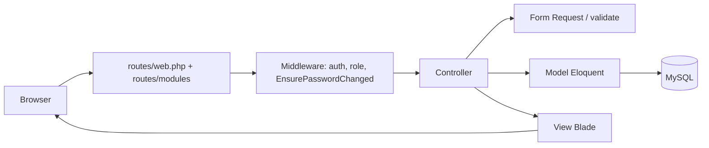
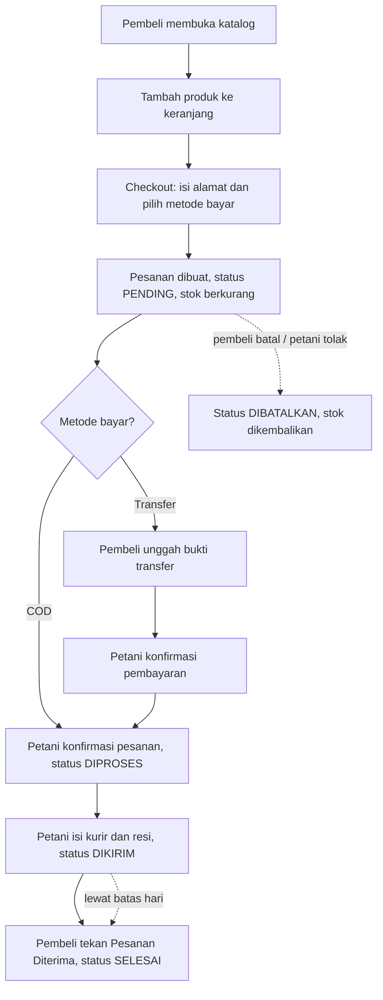
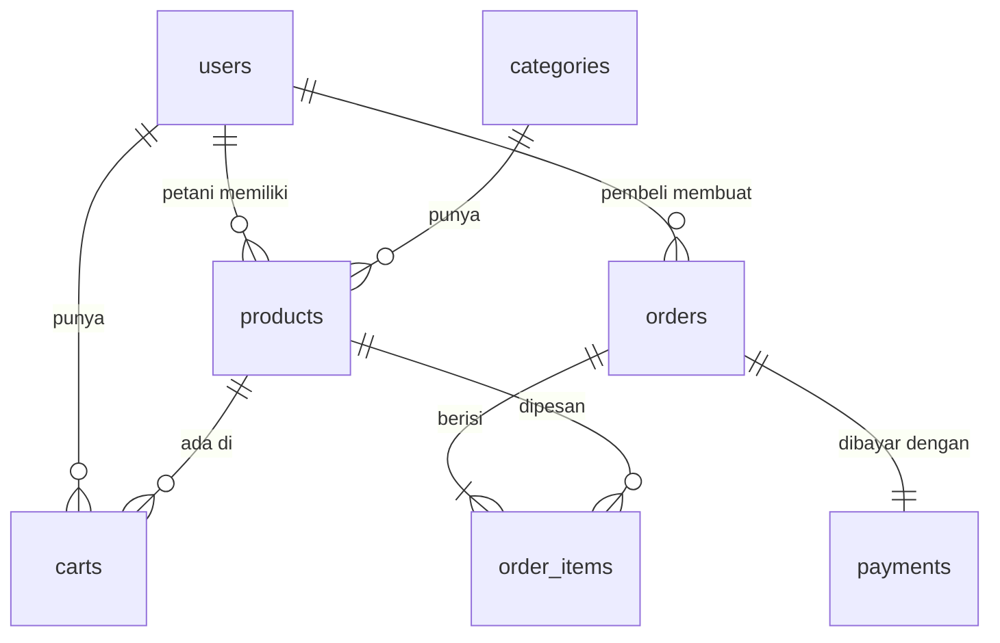

# TaniMart
 
Marketplace hasil pertanian berbasis **Laravel 13** dan **MySQL**. Petani menjual hasil panen langsung ke pembeli, dan admin mengawasi platform. Proyek akhir kelompok 2 mata kuliah Pemrograman Berbasis Website, Universitas Jember.
 
**Teknologi:** PHP 8.3+, Laravel 13, MySQL, Blade, Bootstrap 5, jQuery 3.7, PHPUnit.
 

## Fitur
| Peran | Yang bisa dilakukan |
|---|---|
| **Pembeli** | Melihat katalog (cari, filter kategori, urut harga), memakai keranjang, checkout dengan transfer atau COD, mengunggah bukti transfer, melacak pesanan, membatalkan pesanan, dan mengonfirmasi barang diterima |
| **Petani** | Mengelola produk (foto, harga, stok), menerima atau menolak pesanan, mengonfirmasi atau menolak bukti pembayaran, mengisi kurir dan nomor resi, melihat dashboard, dan mengunduh laporan penjualan (CSV atau cetak) |
| **Admin** | Mengaktifkan atau menonaktifkan petani, mengelola kategori dan pengguna, mereset password pengguna, memantau semua pesanan, dan melihat laporan penjualan seluruh toko |
 
Semua peran bisa login, register, dan mengubah password di halaman profil. Petani yang baru mendaftar berstatus **nonaktif** sampai admin mengaktifkannya. Pembeli langsung aktif.
 
## Memasang dan menjalankan
 
### Prasyarat
- PHP 8.3 atau lebih baru, dengan ekstensi `pdo_mysql`, `mbstring`, `openssl`, `fileinfo`, `ctype`, `tokenizer`, `xml`
- [Composer](https://getcomposer.org)
- MySQL 8 atau MariaDB (di Windows, [Laragon](https://laragon.org) paling mudah)
- Git
Node.js dan npm **tidak diperlukan**. Bootstrap dan jQuery sudah ada di `public/vendor/`, jadi tidak ada langkah build dan aplikasi bisa berjalan offline.
 
### Langkah-langkah
```bash
# 1. Clone dan masuk ke folder proyek
git clone https://github.com/mochammadilham55/TaniMart.git
cd TaniMart
 
# 2. Pasang dependensi PHP
composer install
 
# 3. Siapkan file environment dan kunci aplikasi
cp .env.example .env          # Windows PowerShell: copy .env.example .env
php artisan key:generate
```
 
4. Buat database kosong bernama `tanimart` (lewat HeidiSQL atau phpMyAdmin, atau `mysql -u root -e "CREATE DATABASE tanimart"`). Pastikan isian di `.env` cocok dengan MySQL Anda:
```env
DB_CONNECTION=mysql
DB_HOST=127.0.0.1
DB_PORT=3306
DB_DATABASE=tanimart
DB_USERNAME=root
DB_PASSWORD=
```
 
5. Buat tabel dan isi data awal, lalu tautkan folder penyimpanan foto:
```bash
php artisan migrate --seed
php artisan storage:link
```
 
6. Jalankan aplikasi:
```bash
php artisan serve
```
 
Buka http://127.0.0.1:8000 dan login memakai [akun uji](#akun-uji-dan-data-contoh).
 
> Urutan penting: sesi dan cache aplikasi disimpan di database, jadi `php artisan migrate` harus dijalankan **sebelum** membuka halaman mana pun.
 
## Akun uji dan data contoh
Semua akun memakai password `password`.
 
| Peran | Email |
|---|---|
| Admin | admin@tanimart.test |
| Petani | petani@tanimart.test |
| Petani 2 | petani2@tanimart.test |
| Pembeli | pembeli@tanimart.test |
 
Akun ini hanya untuk pengembangan lokal. Ganti atau hapus sebelum aplikasi dipasang di server sungguhan.
 
Untuk mengisi dashboard dengan pesanan dalam berbagai status:
 
```bash
php artisan db:seed --class=DemoSeeder
```
 
Seeder ini aman dijalankan ulang dan akan dilewati jika pesanan sudah ada.
 
## Konfigurasi
Variabel khusus aplikasi di `.env`:
 
| Variabel | Fungsi | Bawaan |
|---|---|---|
| `TANIMART_SHIPPING_COST` | Ongkos kirim tetap per pesanan (Rp) | `10000` |
| `TANIMART_AUTO_COMPLETE_DAYS` | Pesanan berstatus Dikirim otomatis menjadi Selesai setelah sekian hari jika pembeli tidak menekan "Pesanan Diterima" | `7` |
| `TANIMART_ADMIN_WHATSAPP` | Nomor WhatsApp admin untuk tombol "Hubungi Admin" di halaman login dan lupa password (format `628xxxxxxxxxx`). Kosong berarti tombol disembunyikan | kosong |
 
### Lupa password
Lupa password ditangani lewat admin, bukan lewat email:
1. Pengguna membuka **Lupa password?** di halaman login, mengisi emailnya, lalu menekan **Hubungi Admin via WhatsApp** (perlu `TANIMART_ADMIN_WHATSAPP` diisi).
2. Admin login, membuka **Kelola Pengguna**, mencocokkan identitas pengirim, lalu menekan **Reset Password**. Password sementara tampil satu kali.
3. Pengguna login dengan password sementara dan langsung diarahkan ke Profil untuk menggantinya.
Rute reset lewat email bawaan Laravel (`/lupa-password` dan `/reset-password/{token}`) masih ada di backend dan diuji. `MAIL_MAILER` bawaannya `log`, jadi email tidak benar-benar terkirim kecuali Anda mengatur SMTP.
 
### Penyelesaian pesanan otomatis
Perintah `php artisan orders:auto-complete` menyelesaikan pesanan yang sudah dikirim lebih dari `TANIMART_AUTO_COMPLETE_DAYS` hari. Perintah ini dijadwalkan setiap jam di `routes/console.php`, tetapi jadwal hanya berjalan jika scheduler aktif:
- Lokal: buka terminal kedua dan jalankan `php artisan schedule:work`, atau jalankan perintahnya manual.
- Server: tambahkan cron `* * * * * php /path/ke/proyek/artisan schedule:run`.
## Menjalankan test
Test memakai SQLite in-memory sehingga tidak menyentuh database MySQL Anda. Ekstensi `pdo_sqlite` harus aktif.
 
```bash
php artisan test                           # semua test
php artisan test tests/Feature/Belanja     # satu modul saja
```
 
Folder test: `Core`, `AkunAdmin`, `Produk`, `Belanja`, `PesananMasuk`, dan `Laporan`.
 
## Error yang paling sering muncul
| Pesan atau gejala | Penyebab | Penyelesaian |
|---|---|---|
| `Failed opening required '.../vendor/autoload.php'` | Dependensi belum dipasang | `composer install` |
| `Your PHP version ... does not satisfy that requirement` | PHP di bawah 8.3 | Perbarui PHP ke 8.3+ (di Laragon: ganti versi PHP, lalu buka terminal baru) |
| `No application encryption key has been specified` | `.env` belum punya `APP_KEY` | `php artisan key:generate` |
| `SQLSTATE[HY000] [1049] Unknown database 'tanimart'` | Database belum dibuat atau namanya beda | Buat database, lalu samakan `DB_DATABASE` di `.env` |
| `SQLSTATE[HY000] [2002] Connection refused` | MySQL belum jalan, atau host/port salah | Nyalakan MySQL (Start All di Laragon) dan cek `DB_HOST` dan `DB_PORT` |
| `SQLSTATE[HY000] [1045] Access denied for user` | Username atau password MySQL di `.env` salah | Sesuaikan `DB_USERNAME` dan `DB_PASSWORD` |
| `could not find driver` | Ekstensi PDO belum aktif | Aktifkan `pdo_mysql` (dan `pdo_sqlite` untuk test) di `php.ini`, lalu restart |
| `Table 'tanimart.sessions' doesn't exist` (atau `cache`) | Migration belum dijalankan | `php artisan migrate --seed` |
| Foto produk atau bukti transfer tidak tampil | Tautan storage belum dibuat | `php artisan storage:link` (di Windows, jalankan terminal sebagai Administrator bila gagal membuat symlink) |
| `419 Page Expired` saat submit form | Sesi kedaluwarsa, atau cookie dari host lain (`localhost` vs `127.0.0.1`) | Muat ulang halaman, hapus cookie situs, dan pakai satu alamat saja |
| `403 Anda tidak memiliki akses ke halaman ini` | Login dengan peran yang salah untuk halaman itu | Login dengan akun yang sesuai |
| Petani baru tidak bisa login | Akun petani nonaktif sampai diaktifkan | Login sebagai admin, buka **Kelola Petani**, aktifkan |
| Setelah `git pull` muncul error `Class ... not found` atau tampilan lama | Paket, migration, atau cache belum diperbarui | `composer install`, `php artisan migrate`, lalu `php artisan optimize:clear` |
| `Address already in use` atau port 8000 terpakai | Ada proses lain di port itu | `php artisan serve --port=8001` |
 
Jika masalah belum teratasi, lihat detail error di `storage/logs/laravel.log`. Untuk mengulang dari awal dan **menghapus seluruh data**: `php artisan migrate:fresh --seed`.
 
## Arsitektur
TaniMart adalah aplikasi monolit Laravel dengan pola MVC. Tampilan dirender di server memakai Blade, tanpa API terpisah dan tanpa proses build front-end.
 

 
### Struktur folder
| Folder | Isi |
|---|---|
| `routes/web.php` | Login, register, logout, dan pengalihan `/dashboard` sesuai peran |
| `routes/modules/` | Route fitur per modul: `1-akun-admin.php`, `2-produk.php`, `3-belanja.php`, `4-pesanan-masuk.php` |
| `app/Http/Controllers/` | Dikelompokkan per peran: `Admin/`, `Petani/`, `Pembeli/`, `Auth/`. Logika laporan bersama ada di `Concerns/BuildsSalesReport.php` |
| `app/Http/Middleware/` | `RoleMiddleware` (membatasi akses per peran, menolak akun nonaktif) dan `EnsurePasswordChanged` (memaksa ganti password setelah direset admin) |
| `app/Http/Requests/` | `ProductRequest` untuk validasi produk |
| `app/Models/` | `User`, `Category`, `Product`, `Cart`, `Order`, `OrderItem`, `Payment` |
| `app/Console/Commands/` | `orders:auto-complete` |
| `database/` | Migration dan seeder (`UserSeeder`, `CategorySeeder`, `ProductSeeder`, `DemoSeeder`) |
| `resources/views/` | Blade per peran, `layouts/` (app, guest, public), dan `components/` (badge, stat-card, product-card, password-input, orders-table) |
| `public/` | `css/tanimart.css`, `js/tanimart.js`, dan `vendor/` (Bootstrap, jQuery) |
| `tests/Feature/` | Test per modul |
 
### Hak akses
Route dikelompokkan per peran dengan middleware `auth` dan `role:<peran>`, misalnya petani di `/petani/...` dan admin di `/admin/...`. `RoleMiddleware` menolak peran yang salah dengan 403 dan mengeluarkan akun yang dinonaktifkan. Petani hanya bisa melihat dan mengubah produk serta pesanan miliknya sendiri.
 
### Keputusan teknis yang perlu diketahui
- **Checkout satu transaksi.** Seluruh proses checkout berjalan dalam `DB::transaction` dan memakai `lockForUpdate` pada baris produk, sehingga stok tidak diperebutkan dua pembeli sekaligus.
- **Harga dibekukan.** Harga produk disalin ke `order_items` saat checkout, jadi riwayat pesanan tidak berubah jika harga produk diubah.
- **Satu pesanan per petani.** Keranjang berisi produk dari beberapa petani dipecah menjadi satu pesanan untuk tiap petani.
- **Laporan memakai satu trait.** Query, ringkasan, dan ekspor CSV ada di `BuildsSalesReport`, dipakai laporan petani dan laporan admin.
## Alur sistem

 
| Status | Arti | Yang mengubah |
|---|---|---|
| `pending` | Pesanan baru, menunggu petani | Sistem saat checkout |
| `diproses` | Petani menerima dan mengemas | Petani |
| `dikirim` | Resi sudah diisi | Petani |
| `selesai` | Barang diterima | Pembeli, atau sistem otomatis setelah `TANIMART_AUTO_COMPLETE_DAYS` hari |
| `dibatalkan` | Dibatalkan atau ditolak, stok kembali | Pembeli atau petani (hanya dari `pending`) |
 
Aturan bisnis:
- Stok dikurangi saat checkout. Jika stok salah satu produk kurang, seluruh checkout dibatalkan.
- Pesanan dengan **transfer** harus dikonfirmasi pembayarannya dulu sebelum bisa diproses. **COD** bisa langsung diproses.
- Ongkos kirim tetap per pesanan, diatur lewat `TANIMART_SHIPPING_COST`.
## Struktur database

 
| Tabel | Isi utama |
|---|---|
| `users` | name, email, password, **role** (admin/petani/pembeli), phone, address, rekening bank (petani), is_active, must_change_password |
| `categories` | name, slug |
| `products` | user_id (petani), category_id, name, price, stock, unit, weight, image, is_active |
| `carts` | user_id, product_id, quantity |
| `orders` | user_id (pembeli), total_price, shipping_cost, status, shipping_address, courier, tracking_number |
| `order_items` | order_id, product_id, quantity, price, subtotal |
| `payments` | order_id, amount, method (transfer/cod), status, proof_image |
 
Tabel `cache`, `jobs`, `sessions`, dan `password_reset_tokens` adalah tabel bawaan Laravel.
 
## Pembagian pengerjaan
Proyek dikerjakan empat orang. Setiap anggota memegang satu file route, controller, view, dan folder test.
 
| Anggota | Modul | Yang dikerjakan | File route | Folder test |
|---|---|---|---|---|
| Mochammad Ilham Rizki | Akun dan Admin | Login, register, lupa dan ubah password, profil, hak akses per peran, dashboard admin, kelola petani dan pengguna, pesanan admin, laporan admin | `1-akun-admin.php` | `AkunAdmin`, `Core`, `Laporan` |
| Dana Vatyo Casella | Produk dan Katalog | Katalog publik, produk milik petani (Form Request, pratinjau foto), kategori | `2-produk.php` | `Produk` |
| Bagas Panji Satria | Belanja (sisi pembeli) | Keranjang, checkout, pesanan pembeli, unggah bukti, batal, konfirmasi diterima | `3-belanja.php` | `Belanja` |
| M. Abdul Hafid Khadafi | Pesanan Masuk (sisi petani) | Pesanan masuk, konfirmasi pembayaran, resi pengiriman, dashboard petani, laporan petani | `4-pesanan-masuk.php` | `PesananMasuk` |
 
Urutan pengerjaan yang disarankan karena foreign key: Akun, lalu Produk, lalu Belanja, lalu Pesanan Masuk. Belanja butuh produk, dan Pesanan Masuk butuh pesanan.
 
## Berkontribusi
```bash
git checkout main && git pull
git checkout -b fitur/nama-singkat
# ubah kode, lalu jalankan test
php artisan test
git add <file-yang-diubah>
git commit -m "Tambah filter harga di halaman katalog"
git push -u origin fitur/nama-singkat
```
Lalu buka Pull Request ke `main`.
 
- Jangan push langsung ke `main` dan jangan memakai `git push --force`.
- Jangan commit `.env`. File itu berisi kunci aplikasi dan kredensial.
- Jangan mengedit migration yang sudah di-merge. Buat migration baru dengan `php artisan make:migration nama_perubahan`.
- Pastikan `php artisan test` hijau sebelum push.
